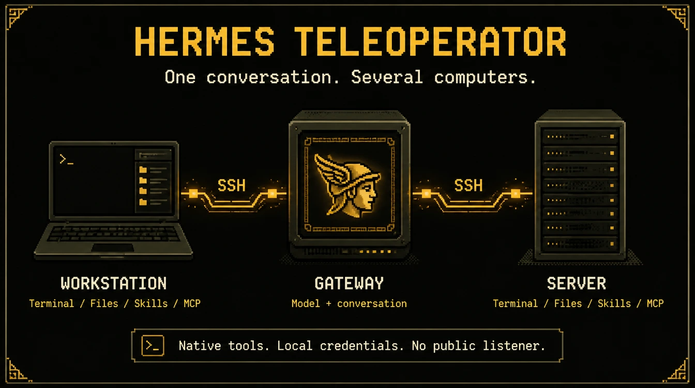
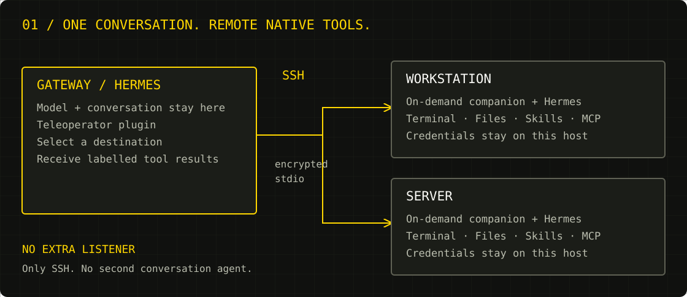
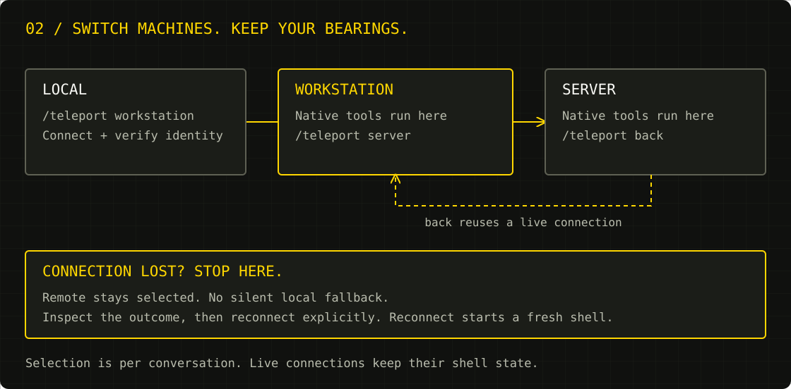

# Hermes Teleoperator - Debug your Mom's PC



One conversation. Several computers. No agent installation on the receiving end.

Teleoperator has two parts:

1. A Python plugin in the Hermes gateway that owns your conversation.
2. A standalone Rust receiver, started on demand over SSH on each destination.

The model and conversation stay on the gateway. The receiver provides shell, files, skills and explicitly configured MCP tools on the destination. It needs no Hermes Agent, Python, Bun, Node, model account or API subscription. It opens no network listener. MCP servers you choose to run may have their own runtime requirements.

## How it fits together





`/teleport back` returns to the previous machine. `/teleport local` returns home. A failed remote call never silently becomes a local command. Switching back reuses shell state while the connection remains open; reconnect starts a fresh shell.

## Requirements

Gateway: Hermes with documented plugin/tool-execution middleware, Python 3.11+, OpenSSH client.

Linux x86_64, aarch64, armv7, i686, riscv64, ppc64le or s390x, macOS 11+ on x86_64 or arm64, an OpenSSH server, Bash and the standalone binary. Installation uses Bash, curl, GNU coreutils and OpenSSH's ssh-keygen when enrolling a key. No language toolchain is needed. Windows is not supported: the receiver is Unix-only by design (openat/linkat/renameat file handling, Unix sockets, POSIX process groups, Bash).

Measured x86_64 musl release build on Linux 7.0.14, 2 vCPU: 2.3 MiB static binary, about 0.5 ms from spawn to first response, roughly 1.4 MiB RSS including its idle Bash shell after 20 commands. Those are `scripts/measure_receiver.py` results, not a comparison against Python/Bun, and exclude SSH and MCP server processes. The receiver exits at stdin EOF; it is not a resident daemon.

## Release targets, libc and linkage

Two linkage models ship for Linux from the same source, because "which libc" is the thing that decides whether a binary runs on an old server:

- **musl, fully static** — no libc, no dynamic loader, no interpreter on the destination. `x86_64`, `aarch64`, `armv7` (musleabihf), `i686`, `riscv64gc`.
- **glibc, dynamic** — linked against a **glibc 2.17 symbol floor**, so it also runs on RHEL/CentOS 7-era systems and anything newer. `x86_64`, `aarch64`, `armv7` (gnueabihf), `i686`, `s390x`. `powerpc64le` uses a **2.19 floor** because zig has no older glibc for that ABI. Pick these when a distro policy wants dynamic binaries or when the host must share a glibc-versioned toolchain.
- **macOS** — `aarch64-apple-darwin` and `x86_64-apple-darwin`. Unsigned and not notarised, so Gatekeeper needs an override.

The static musl binary is the default recommendation. `install.sh` currently auto-downloads Linux x86_64/aarch64 only; other Linux builds require an explicit `--binary` and trusted `--sha256`. The installer is Linux-only and uses GNU utilities: macOS assets require manual installation, not `install.sh`. The glibc floor is enforced in CI: the release job fails if any `GLIBC_*` symbol in a dynamic binary is newer than that target's floor (2.17, or 2.19 for ppc64le).

Test coverage per target is not uniform, and the release notes say so. The full gateway protocol, file transfer, skills, real-SSH and clean-chroot suites run on `x86_64-unknown-linux-musl`. `aarch64-unknown-linux-musl` runs 8 receiver tests under `qemu-aarch64-static` (its clean-chroot test is excluded because the host QEMU wrapper is deliberately absent from that jail). Every other Linux target is cross-compiled and only checked for linkage (`PT_INTERP` present/absent and the glibc floor); macOS binaries are built on a macOS runner but not executed in CI. Emulated timings are not representative.

Version 1.1 replaces the old Python/Hermes receiver. Old `python`/`hermes_home` machine settings are rejected with a migration error, never silently used. The marketplace submission is on hold until the standalone version is validated and pinned.

## Gateway installation

Install this repository as a native directory plugin, using your active Hermes profile:

```sh
mkdir -p "$HERMES_HOME/plugins"
ln -s /absolute/path/to/hermes-teleoperator "$HERMES_HOME/plugins/hermes-teleoperator"
hermes plugins enable hermes-teleoperator
hermes plugins doctor /absolute/path/to/hermes-teleoperator --ci
```

Restart the conversation after enabling it. Alternatively pip-install the gateway package; choose one discovery method, not both. No core files are patched.

Configure and verify normal SSH first. Verify the host fingerprint through a trusted channel. Teleoperator uses strict host-key checking, batch authentication, no agent forwarding, no port forwarding and no automatic mutation retries. SSH aliases and ProxyJump work.

## Receiver installation

Run as the intended SSH user, not through sudo. Root is supported only with explicit `--allow-root`.

Release installation, after a release containing binaries has been published:

```sh
REF=REVIEWED_FULL_COMMIT_SHA
curl -fsSL "https://raw.githubusercontent.com/Tsurgcom/hermes-teleoperator/$REF/install.sh" |
  bash -s -- --version v1.1.1 \
    --public-key 'ssh-ed25519 AAAA... gateway-key'
```

The gateway generates a dedicated key with `ssh-keygen -t ed25519 -f "$HOME/.ssh/teleoperator-workstation"`. Its private key stays on the gateway. Only the public key goes into `--public-key` or `--public-key-file`. For inspection, download and read the script before running it. Do not pipe private keys or credentials into it.

The installer selects a Linux static musl binary by architecture and checks its SHA256 against the release's SHA256SUMS. These checksums detect corrupt/different bytes; they are distributed by the same GitHub release and are not an independent publisher signature. Supply a trusted `--sha256` to pin independently verified bytes. The bootstrap script itself is trusted through its reviewed revision and GitHub HTTPS. Signed release verification is not implemented.

Offline/local build installation:

```sh
cargo build --release --locked --manifest-path receiver/Cargo.toml
BIN=$(realpath receiver/target/release/hermes-teleoperator-receiver)
SUM=$(sha256sum "$BIN"); SUM=${SUM%% *}
bash install.sh --binary "$BIN" --sha256 "$SUM"
```

Cargo is needed on the build machine only. The installer writes `~/.local/lib/hermes-teleoperator/receiver` and a launcher at `~/.local/bin/hermes-teleoperator-receiver`. It rejects unsafe writable/foreign-owned/symlinked installation and SSH path ancestors. It does not install Hermes, start a daemon or alter unrelated keys. Key enrolment uses a same-directory atomic replacement and a `mkdir` lock, preserving existing keys. If an interrupted installer leaves `~/.ssh/.authorized_keys.lock`, remove it only after confirming no installer is running; subsequent installs time out with guidance. Disconnect before upgrading.

When a public key is supplied it is enrolled using `restrict` and a forced launcher command. This restricts connection entry, not shell commands the receiver can execute with the user's authority. Use a dedicated SSH account for narrower authority. Keep separate administrative SSH access: the restricted key cannot run ordinary setup/repair commands.

## Configure the gateway

Create `$HERMES_HOME/teleoperator.json`:

```json
{
  "machines": {
    "workstation": {
      "host": "me@workstation",
      "executable": "/home/me/.local/bin/hermes-teleoperator-receiver",
      "teleoperator_home": "/home/me/.config/hermes-teleoperator",
      "identity_file": "/home/gateway/.ssh/teleoperator-workstation",
      "timeout": 120
    },
    "server": {
      "host": "me@server",
      "executable": "/home/me/.local/bin/hermes-teleoperator-receiver"
    }
  }
}
```

Optional fields: `port`, `known_hosts`. Use absolute paths. `local` is reserved. Keys stay in SSH files or its agent, not this JSON. Settings are read lazily; reload/restart after changes.

## Skills and MCP on the receiver

Receiver configuration lives at `$TELEOPERATOR_HOME`, default `~/.config/hermes-teleoperator`. Skills are ordinary `skills/<name>/SKILL.md` files there. The receiver reads skill text; it does not execute Hermes preprocessing, dependency installers or profile plugins. Existing Hermes installations are optional, not required.

Remote MCP access is off by default. Explicitly configure stdio servers in the receiver's `config.json` and expose only intended names:

```json
{
  "expose_mcp": ["example"],
  "mcp_servers": {
    "example": {
      "command": "/absolute/path/to/mcp-server",
      "args": [],
      "env": {}
    }
  }
}
```

The receiver uses MCP initialize/tools-list/tools-call directly. It advertises no sampling capability and rejects server callbacks requiring a model or interactive approval. It does not load Hermes config, auth stores, plugins or OAuth pools. Credentials come from the SSH user's environment or explicit server environment. HTTP/SSE MCP transports and forwarded interactive approvals are not implemented. Install the dependencies of each chosen MCP server separately.

## Use

```text
/teleport workstation
/teleport status
/teleport server
/teleport back
/teleport local
/teleport disconnect
/teleport reconnect workstation
```

Terminal, file and skill tool names follow the selected computer. The remote implementation is standalone, not the Hermes native dispatcher. Use `teleoperator(action="describe", name="terminal")` for the actual remote schema; unsupported options return errors rather than silently doing something else.

The model-facing gateway supports:

- `action=status|switch|back|reconnect|disconnect`
- `action=search, query="capability"`
- `action=describe, name="<returned-tool-name>"`
- `action=call, name="<returned-tool-name>", arguments={...}`
- Optional `machine` addresses a configured remote without changing selection.
- `action=transfer` with explicit `source_machine`, `source`, `destination_machine`, `destination`, `move=false`.

Transfers support regular files up to 8 MiB, SHA256 verification, no destination overwrite, and copy-before-delete moves. Stop concurrent writers before moving. Use scp/sftp/rsync for large files or directory trees. Transfers do not preserve metadata and are not atomic across two hosts.

## Recovery

There is no service to restart. `/teleport reconnect workstation` starts a fresh receiver through SSH. Do not replay ambiguous mutations without checking whether they ran.

Smoke-test the installed receiver:

```sh
printf '%s\n' '{"id":"health","method":"ping"}' |
  ssh -T -o BatchMode=yes -o StrictHostKeyChecking=yes \
    -i "$HOME/.ssh/teleoperator-workstation" me@workstation \
    '/home/me/.local/bin/hermes-teleoperator-receiver'
```

Expect protocol 2 and runtime `standalone-rust`, then verify a harmless `pwd`. If reconnect fails, switch local, use separate administrative SSH to check `id -un`, `$HOME` and the executable, then rerun the installer if needed. Never use broad `pkill`, restart unrelated agents or disable host-key checks.

Uninstall after disconnecting: remove only the enrolled key line, the launcher, `~/.local/lib/hermes-teleoperator`, and the gateway machine entry. Keep unrelated SSH keys and optional skills/config unless you intend to delete them.

## Boundaries

- Machine selection is conversation-scoped and process-local. A new conversation starts local.
- Disconnect leaves the remote selected; errors never fall back to local.
- Results carry `teleoperator.machine` and hostname. Identity cwd is a connection-time snapshot.
- The prompt, memory, initial skill index and AGENTS.md are not migrated. Load remote instructions explicitly.
- Model execution, browser/desktop, cron, delegation, connectors and local memory stay on the gateway. Unsupported tool names are blocked while remote; switch local to use them. Web search/extract and clarification remain local.
- This is SSH-user authority, not a sandbox. The receiver does not inherit Hermes' native approval/security guards. Remote terminal execution can access everything the SSH user can. Only explicitly exposed MCPs run, but their code is trusted with the same authority.
- Skill text/file semantics, regex search and plain-text patching are not full Hermes feature parity. Document extraction, fuzzy patches, PTY/interactive terminal sessions and HTTP MCP are outside this receiver's initial scope. Use direct SSH/appropriate tooling for those tasks.
- EOF cleans receiver-owned subprocesses. State is preserved only while the channel lives; no daemon, agent or model process remains intentionally resident.

## Build and verify

```sh
cargo test --locked --manifest-path receiver/Cargo.toml
cargo build --release --locked --manifest-path receiver/Cargo.toml
TELEOPERATOR_RECEIVER="$PWD/receiver/target/release/hermes-teleoperator-receiver" \
  python3 -m unittest discover -s tests -v
hermes plugins doctor . --ci
```

The standalone SSH fixture uses an isolated OpenSSH server, temporary keys and receiver homes; it does not modify production SSH configuration. It runs the receiver where Hermes cannot be imported. Two loopback users/homes exercise switching and isolation; a second physical machine is not a claim made by this test.

Layout: `hermes_teleoperator/` is the gateway-only Python plugin; `receiver/` is the Rust companion; `install.sh` installs release binaries; `tests/` covers gateway, installer, process and SSH integration.
